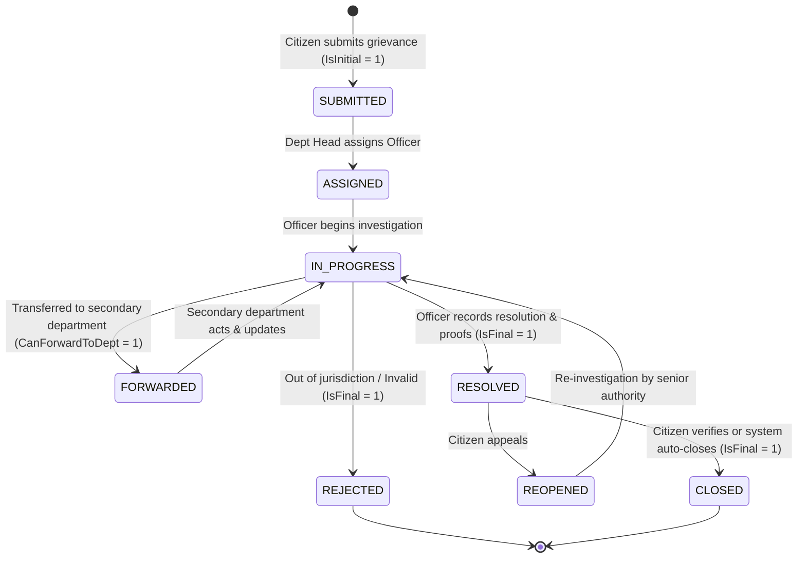

# Grievance Lifecycle, Dynamic Workflow Engine & Architecture

The **Grievance Lifecycle Engine** governs the progression of citizen complaints across municipal authorities from initial submission to final resolution, parallel multi-department delegation, and appeal.

---

## 🔄 Dynamic Workflow State Machine

The system uses a configurable state machine architecture driven by three core database entities:
1. **`[GRV].[GrievanceWorkflow]`**: Container defining custom council resolution pipelines or the system default.
2. **`[GRV].[GrievanceWorkflowState]`**: Dynamic steps (e.g. `SUBMITTED`, `IN_PROGRESS`, `RESOLVED`, `CLOSED`, `REJECTED`).
3. **`[GRV].[GrievanceWorkflowTransition]`**: Permitted transition rules between states, with mandatory remark and department forwarding triggers.

---

## ⚙️ Service Workflow Methods (`GrievanceApplicationService.Workflow.cs`)

### 1. Officer Assignment (`AssignOfficerAsync`)
- Validates the target officer exists and is active (`UserEntity.IsActive == true`).
- Updates `GrievanceApplicationEntity.CurrentAssignedToUserId`.
- Automatically logs an immutable record into `GrievanceActivityLogEntity`.

### 2. Multi-Department Forwarding (`ForwardToDepartmentAsync`)
- Forwards complaints when an issue spans multiple civic departments (e.g. Sanitation + Road Works).
- Inserts a record into `GrievanceDeptForwardingEntity` with status `PENDING`.
- Supports updating the primary department (`UpdatePrimaryDepartment = true`).
- Automatically logs an immutable record into `GrievanceActivityLogEntity`.

### 3. State Transitions (`TransitionStateAsync`)
- Validates against `[GRV].[GrievanceWorkflowTransition]` to ensure the transition is permitted.
- Enforces `RemarkRequired` rules before state change.
- Automatically sets `ResolvedDate = DateTime.UtcNow` when moving to a state where `IsFinal == true` or state name contains `"RESOLV"`.
- Writes state transition metadata to `GrievanceActivityLogEntity`.

---

## 📜 Audit Trail & Multi-Department Delegation

### Immutable Audit Trail (`[GRV].[GrievanceActivityLog]`)
- **Strictly Append-Only**: Never updated or deleted.
- **Triggered automatically** on submission, assignment, forwarding, transitions, and representative pokes/escalations.
- **Drives citizen timelines and SLA analysis**.

### Multi-Department Task Delegation (`[GRV].[GrievanceDeptForwarding]`)
- Allows parallel tasking across departments without splitting the master complaint.
- Tracks sub-task status independently (`PENDING` ➔ `IN_PROGRESS` ➔ `RESOLVED`).
