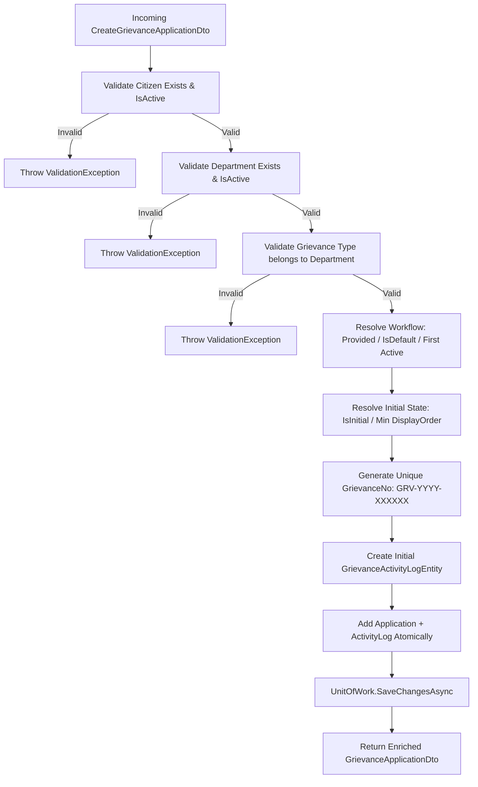
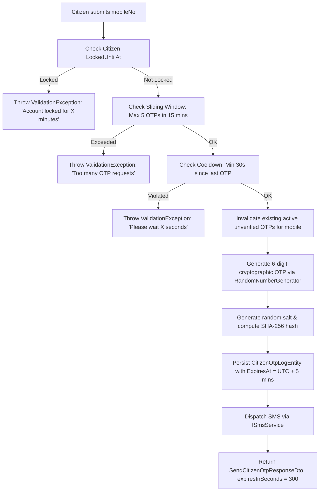

# Grievance Module Service Implementation Deep Dive

This document provides a comprehensive, method-by-method technical explanation of all services, dependency injection graphs, business algorithms, and transaction boundaries in the **Grievance Redressal (GRV) Module**.

---

## 🧩 Service Dependency Injection & Architecture

```mermaid
classDiagram
    class BaseCommonCrudService~TEntity, TDto, TCreateDto, TUpdateDto, TQueryParam, TKey~ {
        <<abstract>>
        #IRepository~TEntity, TKey~ _repository
        #IUnitOfWork _unitOfWork
        #IMapper _mapper
        +GetAllAsync()
        +GetByIdAsync()
        +CreateAsync()
        +UpdateAsync()
        +DeleteAsync()
    }

    class IGrievanceApplicationService {
        <<interface>>
        +GetByGrievanceNoAsync()
        +TrackGrievanceAsync()
        +GetByCitizenIdAsync()
        +AssignOfficerAsync()
        +ForwardToDepartmentAsync()
        +TransitionStateAsync()
        +GetHistoryAsync()
    }

    class GrievanceApplicationService {
        -IRepository~CitizenMasterEntity, int~ _citizenRepository
        -IRepository~GrievanceDepartmentMasterEntity, int~ _departmentRepository
        -IRepository~GrievanceTypeMasterEntity, int~ _typeRepository
        -IRepository~GrievanceWorkflowEntity, int~ _workflowRepository
        -IRepository~GrievanceWorkflowStateEntity, int~ _workflowStateRepository
        -IRepository~GrievanceActivityLogEntity, long~ _activityLogRepository
        -IRepository~GrievanceDeptForwardingEntity, int~ _deptForwardingRepository
        -IRepository~UserEntity, int~ _userRepository
    }

    class GrievanceWorkflowService {
        +ValidateForCreateAsync()
        +ValidateForDeactivationAsync()
    }

    class GrievanceWorkflowStateService {
        -IRepository~GrievanceWorkflowEntity, int~ _workflowRepository
        +ValidateForCreateAsync()
        +ValidateForDeactivationAsync()
    }

    class GrievanceWorkflowTransitionService {
        -IRepository~GrievanceWorkflowEntity, int~ _workflowRepository
        -IRepository~GrievanceWorkflowStateEntity, int~ _workflowStateRepository
        +ValidateForCreateAsync()
        +ValidateForDeactivationAsync()
    }

    class GrievanceDeptForwardingService {
        -IRepository~GrievanceApplicationEntity, int~ _grievanceRepository
        -IRepository~GrievanceDepartmentMasterEntity, int~ _departmentRepository
        +GetByGrievanceIdAsync()
        +GetByDepartmentIdAsync()
    }

    class GrievanceActivityLogService {
        -IRepository~GrievanceActivityLogEntity, long~ _repository
        +GetAllAsync()
        +GetByIdAsync()
        +GetByGrievanceIdAsync()
    }

    BaseCommonCrudService <|-- GrievanceApplicationService
    BaseCommonCrudService <|-- GrievanceWorkflowService
    BaseCommonCrudService <|-- GrievanceWorkflowStateService
    BaseCommonCrudService <|-- GrievanceWorkflowTransitionService
    BaseCommonCrudService <|-- GrievanceDeptForwardingService
    IGrievanceApplicationService <|.. GrievanceApplicationService
```



---

## 1. `GrievanceApplicationService` — Core Implementation

### 1.1 `ApplyIncludes` Query Specification
To prevent N+1 query problems, `ApplyIncludes` eagerly loads all required relations when fetching grievance records:
```csharp
protected override IQueryable<GrievanceApplicationEntity> ApplyIncludes(IQueryable<GrievanceApplicationEntity> query)
{
    return query
        .Include(x => x.Citizen)
        .Include(x => x.GrievanceDepartment)
        .Include(x => x.GrievanceType)
        .Include(x => x.Workflow)
        .Include(x => x.CurrentState)
        .Include(x => x.CurrentAssignedToUser);
}
```

---

### 1.2 `CreateAsync` — Validation & Lodging Algorithm



#### Detailed Execution Steps:
1. **Citizen Verification**: Queries `_citizenRepository` checking `Id == createDto.CitizenId && IsActive == true`.
2. **Department Verification**: Queries `_departmentRepository` checking `Id == createDto.GrievanceDepartmentId && IsActive == true`.
3. **Type-Department Compatibility**: Enforces that the grievance type belongs specifically to the chosen department (`t.GrievanceDepartmentId == createDto.GrievanceDepartmentId`).
4. **Workflow Resolution**: If `createDto.WorkflowId` is omitted, automatically resolves the default workflow marked with `IsDefault == true` or falls back to the first active workflow.
5. **Initial State Resolution**: Queries `_workflowStateRepository` for the state marked `IsInitial == true` for the resolved workflow. If none is marked, falls back to the state with the lowest `DisplayOrder`.
6. **Tracking Number Generation (`GenerateGrievanceNoAsync`)**:
   - Computes prefix `GRV-{CURRENT_YEAR}-` (e.g. `GRV-2026-`).
   - Retrieves the highest existing sequence for that prefix and increments by 1.
   - Formats to 6 digits (e.g. `GRV-2026-000001`).
7. **Atomic Activity Log Creation**: In the same database transaction, creates the initial `GrievanceActivityLogEntity` (`FromStateId: null`, `ToStateId: initialState.Id`, `Remark: "Grievance ticket submitted."`).

---

### 1.3 `UpdateAsync` — Safe Partial Update Handling
When modifying a grievance:
1. Validates that the updated department or type remains active and compatible.
2. Uses AutoMapper to map `UpdateGrievanceApplicationDto` onto the existing entity.
3. Explicitly restores computed foreign key properties to prevent partial payloads from overwriting existing relationships with `0` or `null`.

---

### 1.4 `DeleteAsync` — Cascade & Integrity Safeguards
When soft-deleting a grievance ticket:
1. **Department Forwardings**: Hard-deletes associated records in `GrievanceDeptForwardingEntity` to prevent SQL Server foreign key restriction violations on `GrievanceActivityLogEntity`.
2. **Activity Logs**: Soft-deletes all associated records in `GrievanceActivityLogEntity`.
3. **Application Entity**: Soft-deletes the `GrievanceApplicationEntity` (`IsActive = false`).
4. Commits all deletions within a single unit of work transaction.

---

## 2. `GrievanceApplicationService.Workflow.cs` — Workflow Engine

### 2.1 `AssignOfficerAsync`
- **Signature**: `Task<GrievanceApplicationDto?> AssignOfficerAsync(int grievanceId, AssignGrievanceDto dto, int actionByUserId, CancellationToken ct)`
- **Logic**:
  1. Retrieves the grievance by ID and ensures `IsActive == true`.
  2. Validates that `AssignedToUserId` corresponds to an active user account in `_userRepository`.
  3. Sets `entity.CurrentAssignedToUserId = dto.AssignedToUserId`, `entity.UpdatedBy = actionByUserId`, `entity.UpdatedDate = DateTime.UtcNow`.
  4. Creates a `GrievanceActivityLogEntity` recording `FromStateId = CurrentStateId`, `ToStateId = CurrentStateId`, `AssignedToUserId = dto.AssignedToUserId`, and `Remark = dto.Remark`.
  5. Commits to database via `_unitOfWork.SaveChangesAsync`.

---

### 2.2 `ForwardToDepartmentAsync`
- **Signature**: `Task<GrievanceApplicationDto?> ForwardToDepartmentAsync(int grievanceId, ForwardGrievanceDto dto, int actionByUserId, CancellationToken ct)`
- **Logic**:
  1. Retrieves the grievance and verifies that an active outgoing transition from its current state has `CanForwardToDept == true`.
  2. Validates the target forward department exists and is active.
  3. If `AssignedToUserId` is provided, validates that the destination officer exists.
  4. If `dto.UpdatePrimaryDepartment == true`, updates `entity.GrievanceDepartmentId = dto.ForwardedToDeptId`.
  5. If `dto.AssignedToUserId` is specified, updates `entity.CurrentAssignedToUserId = dto.AssignedToUserId`.
  6. Creates a `GrievanceActivityLogEntity` documenting the forwarding event.
  7. Creates a `GrievanceDeptForwardingEntity` linked to the activity log ID with initial status `"PENDING"`.
  8. Commits all records atomically.

---

### 2.3 `TransitionStateAsync`
- **Signature**: `Task<GrievanceApplicationDto?> TransitionStateAsync(int grievanceId, TransitionGrievanceStateDto dto, int actionByUserId, CancellationToken ct)`
- **Logic**:
  1. Validates destination state `dto.ToStateId` exists and belongs to active workflow states.
  2. Strictly validates against `_workflowTransitionRepository` for allowed, active transitions from `FromStateId` -> `ToStateId` (rejection if no transition rule exists).
  3. Enforces `RemarkRequired` if configured on the transition.
  4. Updates `entity.CurrentStateId = dto.ToStateId`.
  5. If target state is flagged with `IsFinal == true` or state name contains `"RESOLV"`, sets `ResolvedDate ??= DateTime.UtcNow`.
  6. If target state name contains `"CLOSE"`, sets `ClosedDate ??= DateTime.UtcNow`.
  7. If target state name contains `"REOPEN"`, clears `ResolvedDate = null` and `ClosedDate = null`.
  8. Creates a `GrievanceActivityLogEntity` recording `FromStateId` -> `ToStateId`.
  9. Commits changes and returns enriched DTO.

---

## 3. Workflow Configuration Services

### 3.1 `GrievanceWorkflowService`
- **Interface**: `IGrievanceWorkflowService`
- **Logic**:
  - Enforces unique `WorkflowName`.
  - Enforces that only one workflow can be flagged with `IsDefault == true` across the system (aligned with database filtered unique index).
  - Overrides `GetByIdAsync` to eager load related `States` and `Transitions` for accurate state/transition counts in DTO.

### 3.2 `GrievanceWorkflowStateService`
- **Interface**: `IGrievanceWorkflowStateService`
- **Logic**:
  - Validates parent `WorkflowId` exists and is active on create/update.
  - Enforces unique `StateName` per `WorkflowId`.
  - Enforces that only one state per workflow can be marked `IsInitial == true` (validated across all records to match DB unique index and checked during workflow reassignment).
  - Overrides `GetByIdAsync` to eager load parent `Workflow` navigation property.
  - Manages `DisplayOrder` and `IsFinal` flags.

### 3.3 `GrievanceWorkflowTransitionService`
- **Interface**: `IGrievanceWorkflowTransitionService`
- **Logic**:
  - Validates parent `WorkflowId` exists and is active on create/update.
  - Ensures both `FromStateId` and `ToStateId` exist and belong to the same parent `WorkflowId`.
  - Enforces uniqueness of `TransitionName` for a given `FromStateId` -> `ToStateId` pair within the workflow.
  - Overrides `GetByIdAsync` to eager load `Workflow`, `FromState`, and `ToState` navigation properties.
  - Manages `CanForwardToDept` and `RemarkRequired` rules.

---

## 4. Multi-Department Forwarding & Activity Log Services

### 4.1 `GrievanceDeptForwardingService`
- **Interface**: `IGrievanceDeptForwardingService`
- **Logic**:
  - Validates `GrievanceApplicationId` and `ForwardedToDeptId` exist.
  - Validates provided `ActivityLogId` belongs to target grievance or creates audit log record atomically if omitted.
  - Trims and normalizes status against allowed enum set (`PENDING`, `IN_PROGRESS`, `RESOLVED`).
  - Sets `ResolvedAt = DateTime.UtcNow` when status moves to `RESOLVED`.
  - Overrides `GetByIdAsync` to eager load grievance, department, user, and activity log navigation graphs.
  - Provides `GetByGrievanceIdAsync` and paginated `GetByDepartmentIdAsync(departmentId, queryParams)` for department work queues.

### 4.2 `GrievanceActivityLogService`
- **Interface**: `IGrievanceActivityLogService`
- **Logic**:
  - Query-only service preserving append-only immutability.
  - Eagerly loads `FromState`, `ToState`, `Transition`, `ActionByUser`, and `AssignedToUser`.
  - Provides paginated, filtered queries and complete grievance lifecycle histories.

---

## 5. `GrievanceApplicationService.Tracking.cs` — Public Tracking & Calculations

### 5.1 `TrackGrievanceAsync`
- Supports public citizen lookup by `grievanceNo` with optional `mobileNo` validation.
- Eagerly loads full audit logs and joins with `ActionByUser`, `AssignedToUser`, and `DeptForwardings.ForwardedToDept`.
- Computes progress percentage, days open, and returns masked contact information for citizen privacy.

### 5.2 Progress Percentage Formula (`CalculateProgress`)

| State / Condition | Returned Progress |
|---|---|
| `ClosedDate.HasValue == true` | **100%** |
| `ResolvedDate.HasValue == true` OR State contains `"RESOLV"` | **90%** |
| State contains `"PROGRESS"`, `"WORK"`, `"INVESTIGAT"` | **60%** |
| State contains `"ASSIGN"`, `"FORWARD"` | **40%** |
| State contains `"SUBMIT"`, `"PENDING"`, `"NEW"`, `"OPEN"` | **20%** |
| Other intermediate states | **30%** |

### 5.3 Mobile Number Privacy Masking (`MaskMobile`)
For public tracking lookups where full personal phone numbers must not be exposed:
- If mobile number has 10 digits (e.g. `9876543210`), it is formatted as `98****3210` (first 2 digits + 4 asterisks + last 4 digits).
- If length is shorter, masks middle characters dynamically.

### 5.4 `DaysOpen` Metric
Calculates total active elapsed days since submission:
```csharp
var daysOpen = (int)Math.Max(0, (DateTime.UtcNow - entity.SubmittedDate).TotalDays);
```

---

## 6. `CitizenAuthService` — Authentication & Lockout Safeguards

### 6.1 `SendOtpAsync` Execution Flow



### 6.2 `VerifyOtpAsync` Execution Flow
1. Verifies citizen account is not locked.
2. Retrieves latest active `CitizenOtpLogEntity` for the given mobile number.
3. Checks if `ExpiresAt < DateTime.UtcNow` -> Throws expired OTP exception.
4. Checks if `AttemptCount >= 3` -> Inactivates OTP and throws max attempts exceeded exception.
5. Hashes the incoming OTP with the stored salt and compares with `OtpHashed`.
6. **If Mismatch**:
   - Increments `otpLog.AttemptCount`.
   - Increments `CitizenMasterEntity.FailedOtpAttempts`.
   - If `FailedOtpAttempts >= 5`, sets `LockedUntilAt = DateTime.UtcNow.AddMinutes(15)`.
   - Throws validation exception with remaining attempt count.
7. **If Match**:
   - Sets `otpLog.IsUsed = true` and `otpLog.IsActive = false`.
   - Resets `CitizenMasterEntity.FailedOtpAttempts = 0` and `LockedUntilAt = null`.
   - Provisions new citizen record if first-time user.
   - Issues signed JWT Bearer Token (`Role: "Citizen"`, expiry 24h).
   - Computes citizen metrics: `totalGrievancesFiled`, `activeGrievances`, `resolvedGrievances`.
