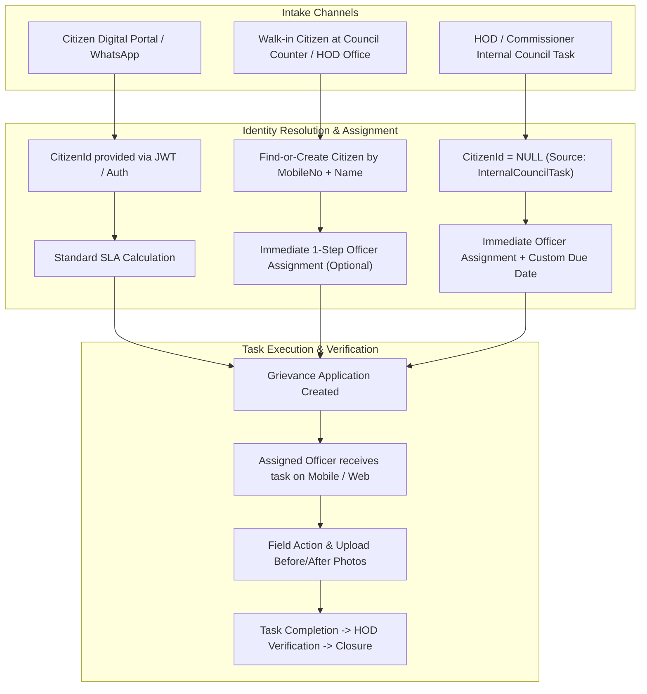

# Architecture & Functional Specification: Admin Intake, Spot Registration & Council Internal Task Management

## 1. Executive Summary & Context

In municipal governance (**Municipal Corporations / ULBs / Nagar Palikas / Nagar Panchayats**), grievances are received and executed through multiple operational channels:
1. **Citizen Digital Channels**: Mobile App, Citizen Web Portal, WhatsApp AI Bot.
2. **Citizen Walk-in / In-Person Counters**: Citizens physically visiting the municipal ward office or HOD chamber (*Jan Sunwai / Samadhan Diwas*).
3. **Internal Council Directives & Staff Tasks**: Tasks initiated internally by the Municipal Commissioner, HOD, Corporator, or Ward Officer (*Suo-Motu complaints, sanitation inspection tasks, urgent infrastructure repairs*) where no external citizen is involved.

This document outlines the end-to-end architecture, domain modeling, DTO schemas, and API design to support these real-world municipal workflows.

---

## 2. Real-World Use Case Scenarios



### Scenario A: Walk-In Citizen Spot Intake (Jan Sunwai / Counter)
- **Problem**: Walk-in citizens do not have registered accounts and do not know any `CitizenId`.
- **Solution**: The HOD/Clerk asks for the citizen's 10-digit **Mobile Number** and **Name**.
- **System Behavior**:
  1. Backend queries `[CORE].[CitizenMaster]` by `MobileNo`.
  2. **If citizen exists**: Reuses existing `CitizenId` (and updates name if previously empty).
  3. **If citizen does not exist**: Automatically creates a new `CitizenMasterEntity` with `IsVerified = true`, generates `CitizenId`, and links the grievance.
  4. Ticket is created, and an SMS/WhatsApp confirmation with Token No (`GRV-2026-XXXXXX`) is dispatched to the citizen's mobile.

### Scenario B: 1-Step Create + Direct Staff Assignment
- **Problem**: Previously, creating a grievance and assigning it required two separate API calls.
- **Solution**: The creation payload accepts `AssignedToUserId` and `AssignmentRemark`.
- **System Behavior**:
  1. Creates the `GrievanceApplicationEntity`.
  2. Sets `CurrentAssignedToUserId`.
  3. Creates `GrievanceActivityLogEntity` with action `Assigned` attributed to the HOD's user account.
  4. Both operations execute inside a single atomic database transaction.

### Scenario C: HOD / Commissioner Internal Council Task (Suo-Motu / Inspection)
- **Problem**: HOD notices an issue during field inspection (e.g. broken water pipe, garbage pile) or Municipal Commissioner issues an internal work order. There is no external citizen.
- **Solution**:
  1. `CitizenId` is set to `null`.
  2. `SourceType` is marked as `InternalCouncilTask` or `Inspection`.
  3. HOD sets `AssignedToUserId` (Junior Engineer / Sanitary Inspector) and an optional `TargetCompletionDate` (e.g., "Complete within 4 hours").
  4. Task enters the officer's active work queue immediately.

---

## 3. Domain Model & Database Schema Enhancements

### 3.1 `GrievanceApplicationEntity` (`[GRV].[GrievanceApplication]`)

| Column | Type | Nullable | Description |
| :--- | :--- | :--- | :--- |
| `CitizenId` | `int` | **Nullable (`int?`)** | Null for internal council tasks; populated for citizen complaints. |
| `SourceType` | `int` / `smallint` | **No** | Enum: `CitizenPortal` (1), `WalkInCounter` (2), `WhatsAppAI` (3), `InternalCouncilTask` (4), `Inspection` (5), `Helpline` (6). |
| `Priority` | `int` / `smallint` | **No** | Enum: `Low` (1), `Medium` (2), `High` (3), `Urgent` (4). Default: `Medium`. |
| `TargetCompletionDate` | `datetime2` | **Nullable** | Custom deadline set by HOD (overrides default SLA for urgent tasks). |
| `CurrentAssignedToUserId` | `int` | **Nullable** | Foreign key to `[CORE].[Users]`. |
| `CurrentStateId` | `int` | **No** | Foreign key to `[GRV].[GrievanceWorkflowStates]`. |
| `WorkflowId` | `int` | **No** | Foreign key to `[GRV].[GrievanceWorkflows]`. |
| `GrievanceDepartmentId` | `int` | **No** | Primary handling department. |
| `GrievanceTypeId` | `int` | **No** | Grievance category/type. |
| `WardId` | `int` | **Nullable** | Administrative Ward. |
| `ZoneId` | `int` | **Nullable** | Administrative Zone. |

---

## 4. DTO Specifications

### 4.1 Enhanced `CreateGrievanceApplicationDto`

```csharp
public class CreateGrievanceApplicationDto : CreateBaseDtos
{
    // --- Citizen Identification (Choose Option A, B, or C) ---
    /// <summary>
    /// Option A: Direct Citizen ID (if already authenticated/known)
    /// </summary>
    public int? CitizenId { get; set; }

    /// <summary>
    /// Option B: Walk-in Citizen Mobile (triggers auto-lookup or auto-registration)
    /// </summary>
    [RegularExpression(@"^[6-9]\d{9}$", ErrorMessage = "Please enter a valid 10-digit mobile number.")]
    public string? MobileNo { get; set; }

    /// <summary>
    /// Option B: Walk-in Citizen Full Name
    /// </summary>
    [StringLength(150, ErrorMessage = "Citizen name cannot exceed 150 characters.")]
    public string? CitizenName { get; set; }

    // --- Grievance & Classification Details ---
    [Required(ErrorMessage = "GrievanceDepartmentId is required.")]
    public int GrievanceDepartmentId { get; set; }

    [Required(ErrorMessage = "GrievanceTypeId is required.")]
    public int GrievanceTypeId { get; set; }

    public int? WardId { get; set; }
    public int? ZoneId { get; set; }

    [StringLength(500, ErrorMessage = "Road / Landmark cannot exceed 500 characters.")]
    public string? RoadLandmark { get; set; }

    [Range(-90.0, 90.0, ErrorMessage = "Latitude must be between -90 and +90.")]
    public decimal? Latitude { get; set; }

    [Range(-180.0, 180.0, ErrorMessage = "Longitude must be between -180 and +180.")]
    public decimal? Longitude { get; set; }

    [StringLength(2000, ErrorMessage = "Description cannot exceed 2000 characters.")]
    public string? Description { get; set; }

    public int? WorkflowId { get; set; }

    // --- Intake Metadata & Task Controls ---
    public GrievanceSourceType SourceType { get; set; } = GrievanceSourceType.WalkInCounter;
    public GrievancePriority Priority { get; set; } = GrievancePriority.Medium;
    public DateTime? TargetCompletionDate { get; set; }

    // --- Instant Officer Assignment (Optional on creation) ---
    public int? AssignedToUserId { get; set; }

    [StringLength(2000, ErrorMessage = "Assignment remark cannot exceed 2000 characters.")]
    public string? AssignmentRemark { get; set; }
}
```

---

## 5. API Endpoints for Council & Admin Operations

| Method | Route | Authorization | Description |
| :--- | :--- | :--- | :--- |
| `POST` | `/api/GrievanceApplication` | `[Authorize]` / Public | Unified creation endpoint supporting Citizen Portal, Walk-in Spot Registration, and HOD Internal Tasks. |
| `POST` | `/api/GrievanceApplication/{id}/assign` | `[Authorize]` | Reassign or assign an officer to an existing grievance. |
| `POST` | `/api/GrievanceApplication/{id}/forward` | `[Authorize]` | Inter-department forwarding with rule validation. |
| `POST` | `/api/GrievanceApplication/{id}/transition` | `[Authorize]` | Advance workflow state (`In Progress` $\to$ `Resolved` $\to$ `Closed`). |
| `GET` | `/api/GrievanceApplication/officer/my-tasks` | `[Authorize]` | Returns all active tasks assigned to the calling officer/engineer (`CurrentAssignedToUserId == currentUserId`). |
| `GET` | `/api/GrievanceApplication/department/{deptId}/tasks` | `[Authorize]` | HOD department overview showing all pending, in-progress, and overdue tasks. |
| `GET` | `/api/CitizenMaster/search?mobile={mobileNo}` | `[Authorize]` | Quick autocomplete endpoint for counter staff to lookup citizen name & history before typing. |

---

## 6. Implementation Strategy & Verification Plan

1. **Phase 1: Entity & Migration**:
   - Make `GrievanceApplicationEntity.CitizenId` nullable (`int? CitizenId`).
   - Add `SourceType`, `Priority`, and `TargetCompletionDate`.
   - Update database migrations.
2. **Phase 2: Service & Validation Logic**:
   - Update `GrievanceApplicationService.CreateAsync` with the **Find-or-Create** logic for `MobileNo`.
   - Add single-shot `AssignedToUserId` handling inside `CreateAsync`.
3. **Phase 3: Query Endpoints for Staff & Officers**:
   - Add `GetAssignedTasksForOfficerAsync` (`/officer/my-tasks`).
   - Add Department Task Inboxes with SLA overdue indicators.
4. **Phase 4: Unit & Integration Tests**:
   - Unit tests covering Walk-in Auto-registration, Internal Task creation without citizen, and Instant Assignment audit logging.

---

## 7. Discussion Points & Decision Checklist

- [ ] **Citizen SMS Notification on Walk-in**: Should we auto-dispatch an SMS/WhatsApp message to walk-in citizens upon ticket creation?
- [ ] **Internal Task Naming**: Confirm enum values for `GrievanceSourceType` (`CitizenPortal`, `WalkInCounter`, `WhatsAppAI`, `InternalCouncilTask`, `Inspection`, `Helpline`).
- [ ] **Permission Controls**: Should any staff member create internal tasks, or restrict to HOD / Admin / Ward Officers?
- [ ] **Photo Proof Requirement**: Should resolving an internal task require at least one photo upload before transition to `Resolved`?
