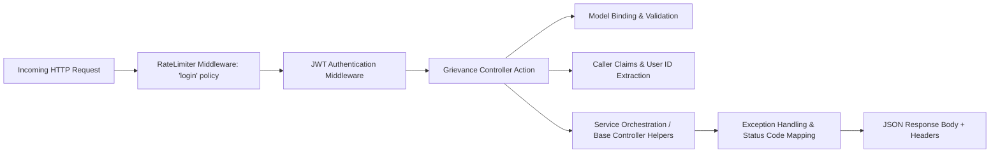

# Grievance Module API Implementation & Controller Deep Dive

This document details the HTTP API presentation layer, controller action methods, request binding pipeline, security middlewares, parameter validation, and error response contracts across the **Grievance Redressal (GRV) Module** controllers.

---

## 🏛️ Controller Layer Architecture & Request Pipeline



---

## 1. Controller Helpers & Execution Extensions

Controllers in the Grievance module utilize standardized extension methods (`this.ExecuteGetAllPaged()`, `this.ExecuteCreate()`, `this.ExecuteGetById()`, `this.ExecuteUpdate()`, `this.ExecuteDelete()`) to ensure consistent HTTP status codes and error serialization across all CRUD entities:

| Controller Helper | Executed Logic | Success Status | Exception Mapping |
|---|---|---|---|
| `ExecuteGetAllPaged` | Calls `_service.GetAllAsync(queryParams, ct)` | `200 OK` (with pagination metadata headers) | `500 Server Error` on unhandled failure |
| `ExecuteGetById` | Calls `_service.GetByIdAsync(id, ct)` | `200 OK` (if found) or `404 Not Found` | `500 Server Error` on unhandled failure |
| `ExecuteCreate` | Calls `_service.CreateAsync(createDto, ct)` | `201 Created` (with `CreatedAtAction`) | `400 Bad Request` on validation failure |
| `ExecuteUpdate` | Calls `_service.UpdateAsync(id, updateDto, ct)` | `200 OK` (if updated) or `404 Not Found` | `400 Bad Request` on validation failure |
| `ExecuteDelete` | Calls `_service.DeleteAsync(id, ct)` | `200 OK` / `204 NoContent` | `404 Not Found` if missing |

---

## 2. `CitizenAuthController` — Authentication & Profile Controller

- **Base Route**: `api/CitizenAuth`
- **Controller Attributes**: `[ApiController]`, `[Route("api/[controller]")]`

### 2.1 `SendOtp` (`POST api/CitizenAuth/send-otp`)
- **Attributes**: `[AllowAnonymous]`, `[EnableRateLimiting("login")]`
- **Binding**: `[FromBody] SendCitizenOtpRequestDto request, CancellationToken ct`
- **Logic**:
  1. Extracts client IP via `HttpContext.Connection.RemoteIpAddress?.ToString()`.
  2. Dispatches to `_citizenAuthService.SendOtpAsync(request, ipAddress, ct)`.
  3. Returns `200 OK` with `SendCitizenOtpResponseDto`.

```csharp
[HttpPost("send-otp")]
[AllowAnonymous]
[EnableRateLimiting("login")]
[ProducesResponseType(typeof(SendCitizenOtpResponseDto), StatusCodes.Status200OK)]
[ProducesResponseType(StatusCodes.Status400BadRequest)]
public async Task<IActionResult> SendOtp([FromBody] SendCitizenOtpRequestDto request, CancellationToken ct)
{
    var ipAddress = HttpContext.Connection.RemoteIpAddress?.ToString();
    var response = await _citizenAuthService.SendOtpAsync(request, ipAddress, ct);
    return Ok(response);
}
```

---

### 2.2 `VerifyOtp` (`POST api/CitizenAuth/verify-otp`)
- **Attributes**: `[AllowAnonymous]`, `[EnableRateLimiting("login")]`
- **Binding**: `[FromBody] VerifyCitizenOtpRequestDto request, CancellationToken ct`
- **Logic**: Validates the OTP hash, resets failed attempt counters, provisions the citizen, issues a signed JWT, and returns `200 OK` with `CitizenAuthResponseDto`.

---

### 2.3 `GetProfile` (`GET api/CitizenAuth/me`)
- **Attributes**: `[Authorize(Roles = "Citizen")]`
- **Claim Extraction**: Extracts `ClaimTypes.NameIdentifier` from `User` principal.
- **Logic**: Returns citizen profile along with live counts for `totalGrievancesFiled`, `activeGrievances`, and `resolvedGrievances`.

```csharp
[HttpGet("me")]
[Authorize(Roles = "Citizen")]
[ProducesResponseType(typeof(CitizenProfileDto), StatusCodes.Status200OK)]
public async Task<IActionResult> GetProfile(CancellationToken ct)
{
    var citizenIdStr = User.FindFirst(ClaimTypes.NameIdentifier)?.Value;
    if (!int.TryParse(citizenIdStr, out var citizenId))
        return Unauthorized(new { message = "Invalid citizen token." });

    var profile = await _citizenAuthService.GetProfileAsync(citizenId, ct);
    return profile == null ? NotFound(new { message = "Citizen profile not found." }) : Ok(profile);
}
```

---

## 3. `GrievanceApplicationController` — Core Operations Controller

- **Base Route**: `api/GrievanceApplication`

### 3.1 Caller User ID Extraction (`GetActionByUserId`)
To attribute audit records in `GrievanceActivityLogEntity` to the active staff user or citizen, the controller extracts the caller ID from available claims with graceful system fallback:
```csharp
private int GetActionByUserId()
{
    var user = HttpContext?.User;
    var claim = user?.FindFirst(ClaimTypes.NameIdentifier)?.Value
        ?? user?.FindFirst("user_id")?.Value
        ?? user?.FindFirst("sub")?.Value;

    if (!string.IsNullOrEmpty(claim) && int.TryParse(claim, out var id) && id > 0)
    {
        return id;
    }

    throw new UnauthorizedAccessException("Authenticated user ID could not be identified from token claims.");
}
```

---

### 3.2 Citizen-Scoped Grievance Queries (`GetByCitizenId`)
- **Route**: `GET api/GrievanceApplication/citizen/{citizenId}`
- **Security Check**: Enforces that authenticated citizens can only query their own grievances.
- **Forbidden Return**: Returns `403 Forbidden` if caller ID does not match route `{citizenId}`.

---

### 3.3 Public Status & Progress Lookup (`TrackGrievance`)
- **Route**: `GET api/GrievanceApplication/track/{grievanceNo}?mobileNo={optionalMobile}`
- **Security**: Publicly accessible without authentication.
- **Privacy**: Automatically returns masked mobile numbers (`98****3210`) to prevent data leakage.

```csharp
[HttpGet("track/{grievanceNo}")]
public async Task<IActionResult> TrackGrievance(string grievanceNo, [FromQuery] string? mobileNo, CancellationToken ct)
{
    var result = await _service.TrackGrievanceAsync(grievanceNo, mobileNo, ct);
    if (result == null)
    {
        return NotFound(new { message = $"No grievance found matching tracking number '{grievanceNo}'." });
    }
    return Ok(result);
}
```

---

### 3.4 Workflow State Transition (`TransitionState`)
- **Route**: `POST api/GrievanceApplication/{id}/transition`
- **Request Body**: `TransitionGrievanceStateDto` (`toStateId`, `assignedToUserId`, `remark`)
- **Exception Handling**:
  - `ValidationException` -> `400 Bad Request` with structured error array.
  - `KeyNotFoundException` -> `404 Not Found`.
  - `Exception` -> `500 Internal Server Error`.

---

## 4. Master & Workflow Configuration Controllers

### 4.1 `GrievanceWorkflowController` (`api/GrievanceWorkflow`)
- `GET api/GrievanceWorkflow` — Paged workflow list with state and transition counts.
- `GET api/GrievanceWorkflow/{id}` — Get workflow definition by ID.
- `POST api/GrievanceWorkflow` — Create workflow (enforces unique name and single default workflow rule).
- `PUT api/GrievanceWorkflow/{id}` — Update workflow properties.
- `DELETE api/GrievanceWorkflow/{id}` — Soft-delete / deactivate workflow.

### 4.2 `GrievanceWorkflowStateController` (`api/GrievanceWorkflowState`)
- `GET api/GrievanceWorkflowState` — List workflow states (filter by `workflowId`).
- `GET api/GrievanceWorkflowState/{id}` — Get state by ID.
- `POST api/GrievanceWorkflowState` — Define workflow state (enforces single `IsInitial` per workflow).
- `PUT api/GrievanceWorkflowState/{id}` — Update state name, display order, or flags.
- `DELETE api/GrievanceWorkflowState/{id}` — Soft-delete state.

### 4.3 `GrievanceWorkflowTransitionController` (`api/GrievanceWorkflowTransition`)
- `GET api/GrievanceWorkflowTransition` — List transition rules.
- `GET api/GrievanceWorkflowTransition/{id}` — Get transition by ID.
- `POST api/GrievanceWorkflowTransition` — Create transition rule (`FromStateId` -> `ToStateId`).
- `PUT api/GrievanceWorkflowTransition/{id}` — Update transition rule / remarks required.
- `DELETE api/GrievanceWorkflowTransition/{id}` — Soft-delete transition.

---

## 5. Forwarding & Activity Log Controllers

### 5.1 `GrievanceDeptForwardingController` (`api/GrievanceDeptForwarding`)
- `GET api/GrievanceDeptForwarding` — Paged list of forwardings.
- `GET api/GrievanceDeptForwarding/{id}` — Get forwarding entry by ID.
- `GET api/GrievanceDeptForwarding/grievance/{grievanceId}` — Get all forwardings for a complaint.
- `GET api/GrievanceDeptForwarding/department/{departmentId}` — Paged Department task inbox with sorting & filtering (`GrievanceDeptForwardingQueryParameters`).
- `POST api/GrievanceDeptForwarding` — Create parallel department forwarding record.
- `PUT api/GrievanceDeptForwarding/{id}` — Update forwarding status (`PENDING`/`IN_PROGRESS`/`RESOLVED`), remark, or officer.
- `DELETE api/GrievanceDeptForwarding/{id}` — Soft-delete forwarding.

### 5.2 `GrievanceActivityLogController` (`api/GrievanceActivityLog`)
- `GET api/GrievanceActivityLog` — Paged & filtered queries across the entire audit log.
- `GET api/GrievanceActivityLog/{id}` — Get single audit log record by `long Id`.
- `GET api/GrievanceActivityLog/grievance/{grievanceId}` — Get chronological action trail for a ticket.

---

## 6. Standardized Error Response Schemas

### 6.1 Validation Error Response (`HTTP 400 Bad Request`)
```json
{
  "message": "Grievance type does not belong to the selected department or is inactive.",
  "errors": [
    {
      "field": "GrievanceTypeId",
      "message": "Active grievance type not found under Department ID 2."
    }
  ]
}
```

### 6.2 Resource Not Found (`HTTP 404 Not Found`)
```json
{
  "message": "GrievanceApplication with ID '999' was not found."
}
```

### 6.3 Forbidden Access (`HTTP 403 Forbidden`)
Returned when an authenticated citizen attempts to access grievance records belonging to another citizen.
